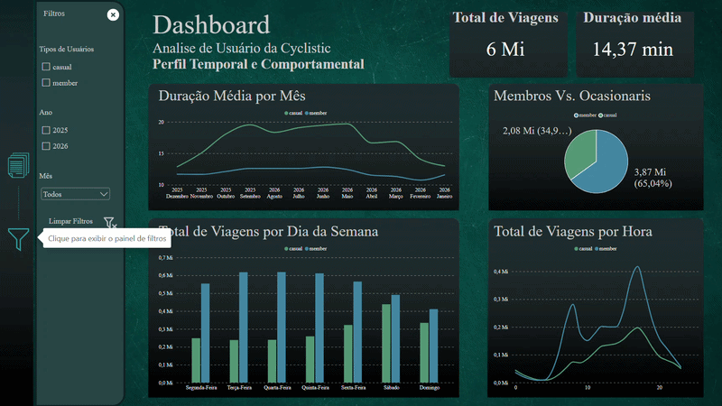
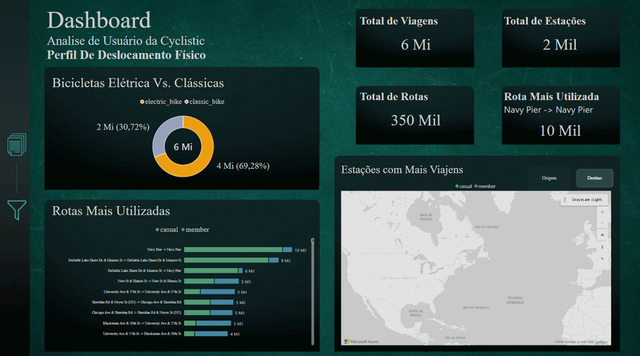

# Cyclistic: Análise do Uso de Bicicletas Compartilhadas

### Members vs. Casuals: como membros anuais e usuários ocasionais utilizam o sistema Divvy


[](https://app.powerbi.com/view?r=eyJrIjoiMTkyMTQ1MDQtNDZmMS00MDAwLTk4OTQtNGQ0ZDBmZjA3NmE5IiwidCI6IjU1ZWRkMDA3LTY2ZTItNDllOS1iZWM3LWU1YWIxYzFiYWMyNiJ9)

---

## Sobre o Projeto

Este projeto analisa 12 meses de viagens do sistema de bicicletas compartilhadas Divvy (Chicago), com base no estudo de caso Cyclistic do curso Google Data Analytics, para responder a uma pergunta: **como os membros anuais (`member`) e os usuários ocasionais (`casual`) utilizam as bicicletas de maneira diferente?**

O trabalho percorre o ciclo completo de análise: consolidação e limpeza dos dados em Python, modelagem e consultas em PostgreSQL e um dashboard interativo no Power BI. Foram analisadas 5.951.477 viagens, de setembro de 2025 a agosto de 2026. O README também reúne os principais números, gráficos e conclusões da análise.

<p align="center">
  <a href="dashbord/gifs/dashbord_temporal_tela1.gif">
    
  </a>
</p>
<p align="center"><sub>Dashboard Power BI, página 1: perfil temporal e comportamental.</sub></p>

---

## Objetivos

| Etapa | Descrição | Status |
| --- | --- | --- |
| Exploração | Estrutura, tipos e consistência dos 12 arquivos mensais | Concluído |
| Limpeza | Ausências, duplicatas, inconsistências temporais e valores extremos | Concluído |
| Variáveis derivadas | Duração da viagem (`ride_length`) e dimensão de calendário (`dim_calendar`) | Concluído |
| Modelagem | Carga no PostgreSQL (`trips` e `dim_calendar`) | Concluído |
| Análise SQL | Perfil, uso mensal, semanal e horário, duração e estações | Concluído |
| Dashboard | Dashboard interativo no Power BI (2 páginas) | Concluído |

---

## Sumário

- [Fluxo do projeto](#fluxo-do-projeto)
- [Dados](#dados)
- [Tecnologias](#tecnologias)
- [Estrutura do repositório](#estrutura-do-repositório)
- [Processo analítico](#processo-analítico)
- [Principais resultados](#principais-resultados)
- [Dashboard](#dashboard)
- [Conclusões gerais](#conclusões-gerais)
- [Limitações](#limitações)
- [Como executar](#como-executar)
- [Possíveis melhorias](#possíveis-melhorias)
- [Autor](#autor)

---

## Fluxo do projeto

```text
Arquivos mensais (CSV)  ->  Python/Pandas  ->  Exploração e limpeza  ->  CSV processado
                                                                              |
                         Power BI  <-  Consultas SQL  <-  PostgreSQL (trips + dim_calendar)
```

## Dados

**Fonte:** [Divvy Trip Data](https://divvy-tripdata.s3.amazonaws.com/index.html), dados públicos de viagens do Divvy. O arquivo de cada mês segue o padrão `YYYYMM-divvy-tripdata.csv`.

**Período:** setembro de 2025 a agosto de 2026 (12 arquivos mensais, 13 colunas cada).

**Variáveis originais:** `ride_id`, `rideable_type`, `started_at`, `ended_at`, `start_station_name`, `start_station_id`, `end_station_name`, `end_station_id`, `start_lat`, `start_lng`, `end_lat`, `end_lng` e `member_casual`.

**Variáveis criadas:**

| Variável | Origem | Descrição |
| --- | --- | --- |
| `ride_length` | Notebook 02 | Duração da viagem em minutos |
| `dim_calendar` | `sql/00_create_dim_calendar.sql` | Tabela de dimensão horária com data, hora, ano, mês, dia da semana e indicador de fim de semana |

**Volume de registros ao longo do tratamento:**

| Etapa | Registros |
| --- | ---: |
| Dados brutos consolidados | 6.115.982 |
| Após remover ausências irrecuperáveis (5.426) | 6.110.556 |
| Após remover duplicatas completas (29) | 6.110.527 |
| Após remover viagens acima de 24 h (174) e de até 1 min (158.876) | **5.951.477** |

## Tecnologias

| Ferramenta | Uso no projeto |
| --- | --- |
| Python, Pandas, NumPy | Consolidação, limpeza e criação de variáveis |
| SciPy (`cKDTree`) | Busca da estação mais próxima para recuperar identificação de estações ausentes |
| Sweetviz, Matplotlib, Seaborn | Perfil inicial dos dados e auditoria de valores ausentes e outliers |
| SQLAlchemy, psycopg2, python-dotenv | Conexão com o PostgreSQL e carga com `COPY`; credenciais lidas do `.env` |
| PostgreSQL | Armazenamento (`trips`, `dim_calendar`) e análise em SQL |
| Power BI | Dashboard interativo em duas páginas |

## Estrutura do repositório

```text
Analise_Cyclistic/
├── data/                       # não versionado
│   ├── raw/                    # CSVs mensais originais
│   ├── raw_zip/                # arquivos compactados baixados
│   └── processed/              # dataset consolidado e dataset tratado
├── notebooks/
│   ├── 01_initial_exploration.ipynb
│   └── 02_data_cleaning.ipynb
├── sql/
│   ├── 00_create_dim_calendar.sql
│   ├── 01_user_profile.sql
│   ├── 02_monthly_usage.sql
│   ├── 03_weekly_usage.sql
│   ├── 04_hourly_usage.sql
│   ├── 05_ride_duration.sql
│   └── 06_station_analysis.sql
├── powerbi/
│   └── cyclistic_dashboard.pbix
├── dashbord/
│   ├── grafich_elements/       # elementos gráficos do dashboard
│   ├── prints/                 # capturas de tela
│   └── gifs/                   # demonstrações de interação
├── README.md
├── requirements.txt
└── .gitignore
```

Os dados e o arquivo `.env` ficam apenas no ambiente local e não são versionados.

## Processo analítico

### 1. Exploração inicial (`01_initial_exploration.ipynb`)

- Carga dos 12 arquivos mensais em um dicionário de DataFrames.
- Verificação de número de linhas e colunas, nomes e tipos de variáveis em cada arquivo.
- Confirmação de que todos os arquivos têm as mesmas colunas e os mesmos tipos.
- Concatenação em um único DataFrame (6.115.982 linhas) e conferência da soma dos registros mensais contra o total consolidado.
- Gravação de `cyclistic_202509_202608.csv`.

### 2. Limpeza e preparação (`02_data_cleaning.ipynb`)

| Problema | Diagnóstico | Decisão |
| --- | --- | --- |
| Ausência de estação e coordenadas | `end_station_*` com 1.349.937 ausências; `end_lat`/`end_lng` com 5.426, todas contidas nas ausências de estação de destino. Nome e ID de cada estação ausentes nos mesmos registros | Imputação da estação a partir das coordenadas, com a estação de referência mais próxima (`cKDTree`) |
| Chave da estação | Um mesmo nome aparece com várias coordenadas e, em alguns casos, com mais de um ID | `station_id` adotado como chave; coordenada de referência definida como a coordenada START mais frequente de cada ID. Validação contra a coordenada END mais frequente: concordância em 1.977 de 1.980 IDs (99,85%) |
| Ausências remanescentes | 5.426 registros (0,09%) sem recuperação confiável | Removidos |
| Duplicatas | 29 registros totalmente duplicados | Removidos |
| `ended_at` anterior a `started_at` | 29 registros, todos em 02/11/2025 às 01h, no fim do horário de verão em Chicago | Mantidos, com 1 hora somada a `ride_length` |
| Viagens acima de 24 h | 174 registros (0,0028%) | Removidas |
| Viagens de até 1 minuto | 158.876 registros (2,60%); 81,83% começam e terminam na mesma estação, sem concentração em uma estação específica | Removidas (limite mínimo operacional) |
| Outliers pelo critério IQR | 423.123 registros (6,92%) acima de 32,34 min, em distribuição assimétrica | Mantidos: duração elevada pode ser comportamento real |
| Viagens com mesma estação de início e fim | 393.328 registros | Mantidos |

Também foram verificadas as variáveis categóricas (`member_casual` e `rideable_type` sem valores inesperados) e as coordenadas (nenhum valor fora do intervalo válido nem igual a zero). O dataset final foi revalidado quanto a inconsistências, duplicatas, ausências e duração, e salvo como `cyclistic_202509_202608_processed.csv`.

### 3. Carga e modelagem no PostgreSQL

- O notebook 02 cria o banco (se não existir) e a tabela `trips` com 14 colunas, e carrega o CSV tratado com `COPY`. A contagem na tabela confere com o dataset: 5.951.477 registros.
- `sql/00_create_dim_calendar.sql` cria `dim_calendar`, dimensão horária de 2025-09-01 a 2026-08-31, com chave `datetime_key`. As consultas ligam `trips` à dimensão por `DATE_TRUNC('hour', started_at)`, em um esquema estrela simples (fato e dimensão).

### 4. Consultas SQL

| Arquivo | Análise |
| --- | --- |
| `01_user_profile.sql` | Distribuição por tipo de usuário, duração média e mediana, tipo de bicicleta |
| `02_monthly_usage.sql` | Volume mensal, distribuição mensal por grupo, mês de pico, duração por mês e análise por estação do ano |
| `03_weekly_usage.sql` | Viagens por dia da semana, dia útil vs. fim de semana, dia de pico, média diária por dia da semana |
| `04_hourly_usage.sql` | Viagens por hora, hora de pico, distribuição por período do dia e tipo de dia |
| `05_ride_duration.sql` | Duração média e mediana por dia, hora, período e grupo; distribuição por faixa de duração |
| `06_station_analysis.sql` | Estações e rotas distintas, principais estações de origem e destino, duração por estação, estação líder por dia, rotas mais usadas por grupo |

Recursos utilizados: CTEs, funções de janela (`ROW_NUMBER`, `SUM() OVER`), `FILTER`, `PERCENTILE_CONT` para a mediana, `JOIN` com a dimensão, `CASE` e `HAVING`. Para durações por estação, foram consideradas apenas estações com pelo menos 100 viagens.

## Principais resultados

### Volume e tipo de bicicleta

`member` responde por 3.870.643 viagens (65,04%) e `casual` por 2.080.834 (34,96%). Bicicletas elétricas predominam nos dois grupos, com participação um pouco maior entre `casual`.

| Grupo | Elétricas | Clássicas | % elétricas |
| --- | ---: | ---: | ---: |
| casual | 1.514.975 | 565.859 | 72,81% |
| member | 2.608.278 | 1.262.365 | 67,39% |

### Padrão semanal

O sábado concentra a maior parte das viagens no conjunto (15,62%). `member` tem seu pico na quarta-feira e `casual` no sábado.

| Grupo | Dias úteis | Fins de semana | % em dias úteis |
| --- | ---: | ---: | ---: |
| member | 2.968.134 | 902.509 | 76,68% |
| casual | 1.307.763 | 773.071 | 62,85% |

> **Achado-chave:** `member` concentra 76,68% das viagens em dias úteis, contra 62,85% de `casual`. O uso de `casual` é proporcionalmente maior nos fins de semana.

### Padrão horário

As 17h são o horário de maior uso nos dois grupos (member: 417.885 viagens; casual: 197.592). Na distribuição por período, `member` concentra mais viagens na manhã que `casual` em termos relativos; `casual` tem participação maior à noite e na madrugada.

| Período | Member | Casual |
| --- | ---: | ---: |
| Tarde | 1.643.820 | 941.247 |
| Manhã | 1.151.763 | 433.873 |
| Noite | 986.150 | 594.890 |
| Madrugada | 88.910 | 110.824 |

<p align="center">
  <a href="dashbord/prints/Captura_de_tela_2026-10-13_095309.png">
    
  </a>
</p>
<p align="center"><sub>Perfil temporal e comportamental: a curva horária de member mostra picos pela manhã e às 17h; os fins de semana aproximam os dois grupos.</sub></p>

### Duração das viagens

A duração média geral é de 14 min 22 s (14,37 min). `casual` tem duração média maior que `member` em todos os dias e períodos analisados, e varia mais entre os dias.

| Grupo | Maior média por dia | Menor média por dia |
| --- | --- | --- |
| casual | Domingo: 21,22 min | Quarta-feira: 15,25 min |
| member | Sábado: 13,46 min | Quarta-feira: 11,69 min |

No gráfico de duração média por mês do dashboard, a linha de `casual` fica acima da de `member` em todos os meses e oscila bem mais ao longo do ano.

A distribuição por faixa mostra que `member` concentra mais viagens curtas e `casual` tem cauda mais longa:

| Faixa | Casual | Member |
| --- | ---: | ---: |
| Até 10 min | 44,28% | 57,03% |
| 11 a 20 min | 30,38% | 28,76% |
| 21 a 30 min | 11,72% | 8,77% |
| 31 a 60 min | 9,62% | 4,79% |
| 61 a 120 min | 3,17% | 0,47% |
| Mais de 120 min | 0,83% | 0,19% |

> **Achado-chave:** 57,03% das viagens de `member` duram até 10 minutos, contra 44,28% de `casual`. Acima de 30 minutos, a participação de `casual` é de 13,62% e a de `member`, 5,45%.

### Estações

A composição das estações de maior volume é bastante desigual entre os grupos:

| Estação de início | Viagens | Member | Casual |
| --- | ---: | ---: | ---: |
| Navy Pier | 66.991 | 24,07% | 75,93% |
| Canal St & Adams St | 61.279 | 77,25% | 22,75% |
| DuSable Lake Shore Dr & Monroe St | 56.235 | 27,94% | 72,06% |
| Dearborn Pkwy & Delaware Pl | 55.111 | 70,65% | 29,35% |
| Kingsbury St & Kinzie St 2 | 46.625 | 76,35% | 23,65% |

> **Achado-chave:** entre as viagens que começam em Navy Pier, 75,93% são de `casual`; em Canal St & Adams St, 77,25% são de `member`. As estações de maior volume são, em geral, dominadas por um dos grupos.

- Navy Pier é a principal estação de início de `casual` em todos os dias da semana (13.299 viagens no sábado, maior valor da análise) e também a principal estação de destino (66.720 viagens, 78,05% casual).
- Entre `member`, Canal St & Adams St lidera de segunda a quinta; Dearborn Pkwy & Delaware Pl lidera de sexta a domingo.
- Entre as estações com mais de 100 viagens, a maior duração média é de Cumberland Ave & Catherine Ave (65,18 min; mediana de 34,28 min) e a menor é de Public Rack - Pulaski Rd & 44th St (4,26 min). A diferença entre média e mediana indica distribuições assimétricas.

<p align="center">
  <a href="dashbord/prints/Captura_de_tela_2026-10-13_095254.png">
    
  </a>
</p>
<p align="center"><sub>Perfil de deslocamento físico: tipo de bicicleta, rotas mais utilizadas e estações com mais viagens (modo Origem).</sub></p>

### Rotas

| Grupo | Rotas de maior volume |
| --- | --- |
| casual | Navy Pier -> Navy Pier (9.482); DuSable Lake Shore Dr & Monroe St -> mesma estação (8.148); DuSable Lake Shore Dr & Monroe St -> Navy Pier (5.212); Michigan Ave & Oak St -> mesma estação (3.509) |
| member | Blackstone Ave & 59th St -> University Ave & 57th St (3.421); University Ave & 57th St -> mesma estação (3.362); University Ave & 57th St -> Blackstone Ave & 59th St (3.232); Ellis Ave & 60th St -> University Ave & 57th St (3.194) |

As rotas de `casual` concentram-se em Navy Pier e DuSable Lake Shore Dr, com muitas viagens de origem e destino iguais. As de `member` envolvem sobretudo deslocamentos entre estações distintas na região de University Ave, Blackstone Ave e Ellis Ave.

---

## Dashboard

O dashboard está publicado no [Power BI Web](https://app.powerbi.com/view?r=eyJrIjoiMTkyMTQ1MDQtNDZmMS00MDAwLTk4OTQtNGQ0ZDBmZjA3NmE5IiwidCI6IjU1ZWRkMDA3LTY2ZTItNDllOS1iZWM3LWU1YWIxYzFiYWMyNiJ9) e o arquivo-fonte está em `powerbi/cyclistic_dashboard.pbix`. Ele tem duas páginas, ambas com painel de filtros (ícone de funil) e botão para limpar filtros. Os visuais são recalculados conforme os filtros aplicados.

**Página 1: Perfil Temporal e Comportamental**
- Indicadores: total de viagens e duração média.
- Visuais: duração média por mês, proporção casual vs. member, viagens por dia da semana e viagens por hora, cada um com a separação por tipo de usuário.
- Filtros: tipo de usuário, ano e mês.

**Página 2: Perfil de Deslocamento Físico**
- Indicadores: total de viagens, total de estações (cerca de 2 mil), total de rotas (cerca de 350 mil) e rota mais utilizada (Navy Pier -> Navy Pier, cerca de 10 mil viagens).
- Visuais: bicicletas elétricas vs. clássicas, rotas mais utilizadas por tipo de usuário e mapa das estações com mais viagens, com alternância entre Origem e Destino.
- Filtros: tipo de usuário, tipo de bicicleta e estação.

A demonstração abaixo mostra a página 2 com filtros aplicados: ao selecionar `member`, os indicadores, o gráfico de bicicletas, as rotas e o mapa são recalculados.

<p align="center">
  <a href="dashbord/gifs/dashbord_deslocamento_tela2.gif">
    
  </a>
</p>
<p align="center"><sub>Página 2: filtragem por tipo de usuário, tipo de bicicleta e estação.</sub></p>

O modo Destino do mapa:

<p align="center">
  <a href="dashbord/prints/Captura_de_tela_2026-10-13_095239.png">
    
  </a>
</p>
<p align="center"><sub>Estações com mais viagens, modo Destino.</sub></p>

---

## Conclusões gerais

1. **O calendário de uso é diferente.** `member` usa o sistema principalmente em dias úteis, com pico na quarta-feira e picos pela manhã e às 17h. `casual` tem pico no sábado e maior participação nos fins de semana.
2. **A duração das viagens diverge.** `casual` pedala por mais tempo, com maior variação entre dias e períodos. `member` concentra viagens curtas e com duração mais estável.
3. **A bicicleta elétrica predomina nos dois grupos**, com participação um pouco maior entre `casual` (72,81%) do que entre `member` (67,39%).
4. **A localização separa os grupos.** Navy Pier e DuSable Lake Shore Dr & Monroe St concentram `casual`; Canal St & Adams St, Dearborn Pkwy & Delaware Pl e a região de University Ave concentram `member`.
5. **A finalidade das viagens não é observável.** Os dados descrevem quando, quanto tempo e onde cada grupo pedala. Os resultados são apresentados como padrões de uso, sem atribuir motivação às viagens.

Síntese comparativa:

| Dimensão | Member | Casual |
| --- | --- | --- |
| Semana | Concentração em dias úteis (76,68%); pico na quarta-feira | Participação maior nos fins de semana (37,15%); pico no sábado |
| Horário | Picos pela manhã e às 17h | Pico às 17h; mais viagens à noite e na madrugada em termos relativos |
| Duração | Média menor e mais estável; 57,03% das viagens até 10 min | Média maior e mais variável; 55,72% das viagens acima de 10 min |
| Bicicleta | 67,39% elétricas | 72,81% elétricas |
| Estações | Canal St & Adams St, Dearborn Pkwy & Delaware Pl | Navy Pier, DuSable Lake Shore Dr & Monroe St |

---

## Limitações

- A imputação de estações usa a estação de referência mais próxima das coordenadas, sem distância máxima. As análises de estações e rotas incluem esses registros imputados.
- Uma mesma estação pode ter várias coordenadas e, em poucos casos, mais de um ID. A coordenada de referência de cada ID é a mais frequente, não uma posição oficial.
- O corte de 1 minuto e o de 24 horas são critérios operacionais definidos neste projeto. Foram removidas 158.876 viagens curtas, e viagens longas entre 32 min e 24 h foram mantidas.
- Os resultados são descritivos. As diferenças entre os grupos não foram submetidas a testes estatísticos e não indicam causa.

## Como executar

Pré-requisitos: Python 3, PostgreSQL e Power BI Desktop.

1. Crie o ambiente virtual e instale as dependências:

   ```bash
   python -m venv .venv
   source .venv/bin/activate        # Windows: .venv\Scripts\activate
   pip install -r requirements.txt
   ```

2. Baixe os 12 arquivos mensais, de `202509` a `202608`, da [fonte oficial](https://divvy-tripdata.s3.amazonaws.com/index.html) e extraia os CSVs em `data/raw/` (os arquivos originais compactados ficam em `data/raw_zip/`). Crie também `data/processed/`.

3. Crie o arquivo `.env` na raiz com as variáveis de conexão do PostgreSQL (sem versionar):

   ```text
   DB_USER=
   DB_PASSWORD=
   DB_HOST=
   DB_PORT=
   DB_NAME=
   ```

4. Execute os notebooks em ordem, a partir da pasta `notebooks/`: `01_initial_exploration.ipynb` e `02_data_cleaning.ipynb`. O segundo gera o CSV tratado e carrega a tabela `trips`.

5. Execute os scripts SQL, começando por `sql/00_create_dim_calendar.sql`, e depois `01` a `06`:

   ```bash
   psql -d <DB_NAME> -f sql/00_create_dim_calendar.sql
   ```

6. Abra `powerbi/cyclistic_dashboard.pbix` no Power BI Desktop.

## Autor

**Alessandro Moreira Cecilio**

[](https://github.com/AleCecilio)
[](https://www.linkedin.com/in/alessandro-cecilio/)

*Projeto desenvolvido para portfólio em Análise e Ciência de Dados.*
